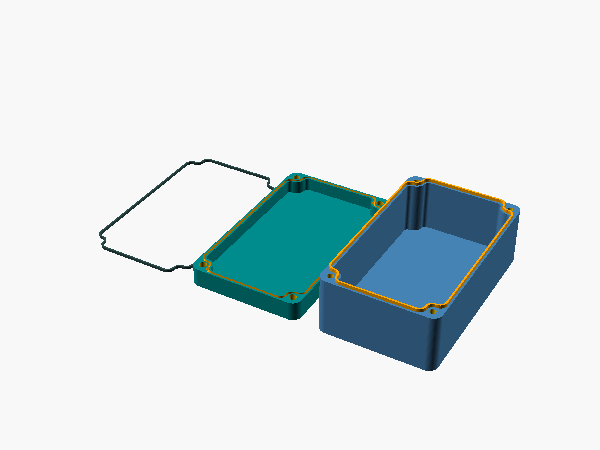
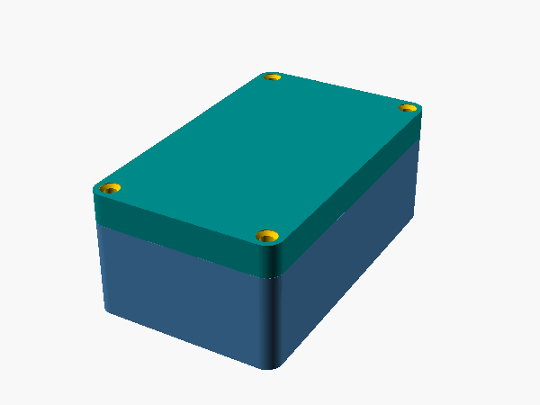
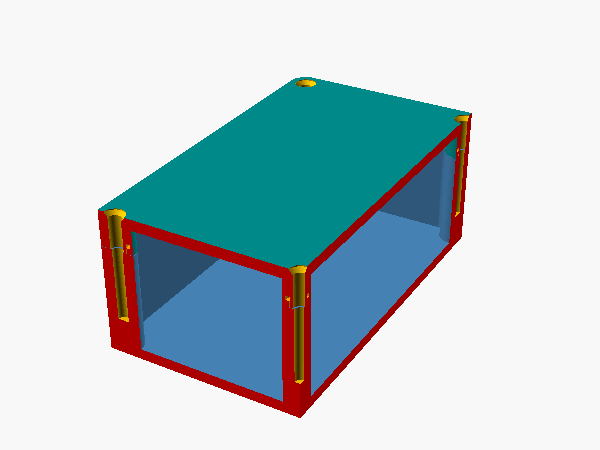
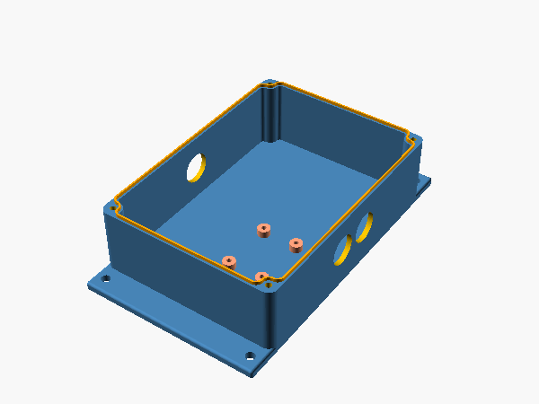

# parametric-electrical-enclosure

A parametric, waterproof enclosure for electronics, designed in OpenSCAD for 3D
printing. You set the size, and it builds a bottom and lid that seal with a
groove and ridge (with an optional cord or TPU gasket), screwed together at the
corners, with optional cable-gland holes, board standoffs and wall mounts. No
supports needed.

| Assembled | Section through the seal and screws | Wall-mounted, with glands and a board |
| --- | --- | --- |
|  |  |  |

## Use it

1. Open `enclosure.scad` in [OpenSCAD](https://openscad.org) and show the
   Customizer panel.
2. Start from the defaults or a preset (below), and set the size and features.
3. Read the console: it prints the inner and outer size, and the screw length
   to buy.
4. Export each part on its own: turn off two of `ShowBottom`, `ShowTop` and
   `ShowGasket` at a time. Raise `$fn` to 150 or more before the final render.

For a waterproof case, print with 100 % infill. With standard or square nuts,
pause the print at the nut layer to drop them in.

### Presets

`enclosure.json` sits next to the file, so the Customizer lists its presets:

- **Wall-mounted, two cable glands and a board**: 100 × 140 × 50 mm, two holes
  on side A and one on side C, a set of board standoffs, and wall-mount
  flanges with two holes each. It's the picture above.
- **Large, with extra screws on both sides**: 200 × 150 × 60 mm, split 20 mm
  from the top, with extra screws midway along each side.

## Parameters

The Customizer groups them; these are the main ones in each group.

| Group | Parameters |
| --- | --- |
| View | `ShowBottom`, `ShowTop`, `ShowGasket`, `ShowCaseAssembled`, `DistanceBetweenObjects`, `GasketHeight` |
| Cuts | `SeeNutCut`, `SeeGrooveRidgeScrew`: section views, one at a time |
| Case | `Caselength`, `CaseWidth`, `CaseHeight` (outside size), `CutFromTop` (lid height), `BottomTopThickness`, `CaseRadius` |
| Groove | `GrooveWidth` (the cord's diameter, or a multiple of the nozzle), `GrooveDepth`, `Space` (fit), `AddGrooveDepthForSealing` (room for a cord), `InnerBorder`, `OuterBorder` |
| Screws | `MetricScrewSize` (M2 to M5), `ScrewHeadType` (countersunk, counterbored or exposed), `ScrewHeadHeight`, `ScrewHeadDiameter`, `HoleDeepness`, `XAdditionalScrew`, `YAdditionalScrew` |
| Nuts | `NutStyle`: 1 heat-set insert or self-tapping, 2 hex nut, 3 square nut, 4 square nut inserted from the side; `NutSink`, and each style's sizes |
| Wall mount | `EnableMountHolder`, `MountHolderStyle` (1 to 5), `CountOfMountHolderHoles`, `MountHolderHoleDiameter`, `MountHolderThickness` |
| Board standoffs | Three sets: `ShowDeviceHolder1` to `3`, each with hole and standoff diameter, height, spacing in x and y, and offset |
| Floor holes | `ShowBottomMountingHoles`, with diameter, spacing and offset. Not for a waterproof case. |
| Side holes | Sides A (+x), B (−y), C (−x) and D (+y): `ShowSideWallHoles_A`, `CountOfSideWallHoles_A` (1 to 3), `SideWallHoleDiameter_A`, height offset, spacing and position, and the same for B, C and D |

## Checks

`just test` takes about 2 s on OpenSCAD 2026.10.15. It renders the bottom,
lid, gasket and assembled case at the defaults, at two other sizes and with
both presets. It checks each part's size, that the bottom and lid are one
piece each, and that assembled they're two: the ridge doesn't reach the lid.
`just images` renders the pictures in this README.

## Origin and licence

The enclosure started as pbtec's
[Stable and waterproof OpenSCAD case](https://www.printables.com/model/72839-customizable-parametric-stable-and-waterproof-elec),
version 7.2, and is licensed, as that is, under
[CC BY-NC-SA 4.0](https://creativecommons.org/licenses/by-nc-sa/4.0/): credit
pbtec, no commercial use, and share changes under the same licence. See
[LICENSE](LICENSE). The version table in `enclosure.scad` records the changes
made here. The first, 7.2.1, seats the ridge 0.01 mm into the bottom's rim:
it sat 0.01 mm above it, and the bottom exported as two separate bodies.
