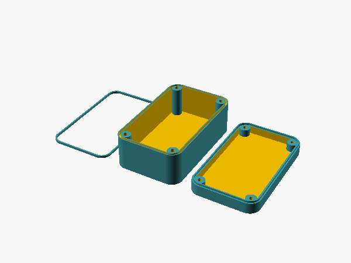
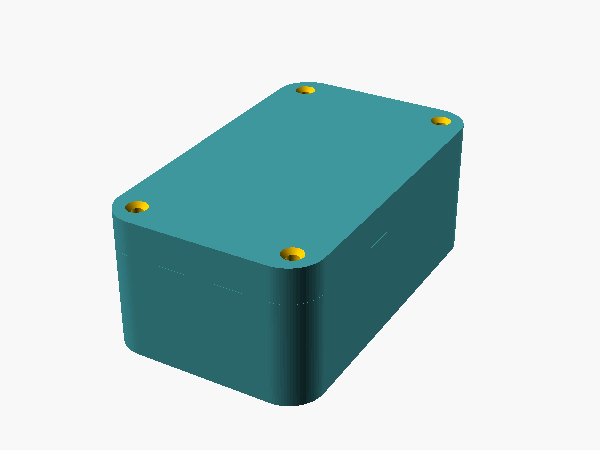
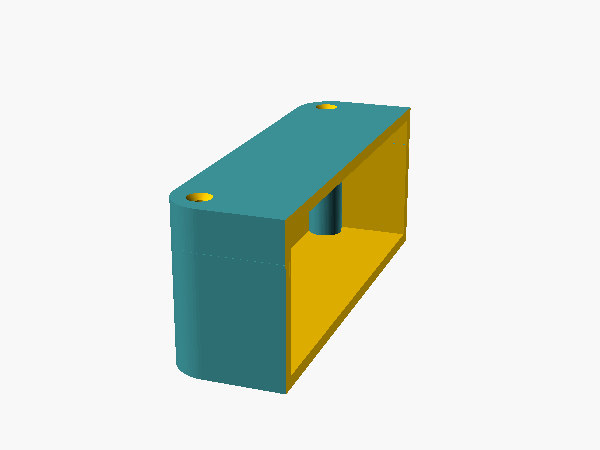
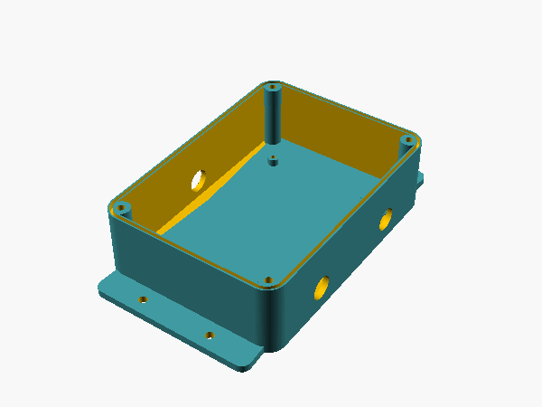

# parametric-electrical-enclosure

A parametric, waterproof enclosure for electronics, designed in OpenSCAD for 3D
printing. You set the size, and it builds a bottom and a lid that seal with a
groove and ridge (with an optional TPU gasket), screwed together through
pillars at the corners, with optional cable-gland holes, board standoffs and
wall-mount flanges. No supports needed.

| Assembled | Cut in half | Wall-mounted, with glands and a board |
| --- | --- | --- |
|  |  |  |

## Use it

1. Open `enclosure.scad` in [OpenSCAD](https://openscad.org) and show the
   Customizer panel.
2. Start from the defaults or a preset (below), and set the size and features.
3. Read the console: it prints the outside and inside size, and how many
   screws you need and how long.
4. Export each part on its own: set `part` to `bottom`, `lid` or `gasket`.

Print the bottom as it sits and the lid top down; neither needs supports. For a
waterproof case, print with 100 % infill around the seal, and print the gasket
in TPU. With hex nuts, the nuts go into pockets under the floor.

### Presets

`enclosure.json` sits next to the file, so the Customizer lists its presets:

- **Wall-mounted, two cable glands and a board**: 100 × 140 × 50 mm, two holes
  in wall A and one in wall C, board standoffs, and wall-mount flanges with
  two holes each. It's the picture above.
- **Large, with extra screws on both sides**: 200 × 150 × 60 mm, a 20 mm lid,
  and a screw midway along each side as well as at the corners.

## Parameters

| Group | Parameters |
| --- | --- |
| View | `part`: `all` (laid out for printing), `bottom`, `lid`, `gasket`, `assembled`, `section` |
| Case | `length`, `width`, `height` (outside, closed), `lid_height`, `wall`, `floor_thickness`, `corner_radius` |
| Seal | `groove_width`, `groove_depth`, `fit` (clearance each side of the ridge), `gasket`, `gasket_height` |
| Screws | `screw` (M2 to M5), `head` (countersunk or counterbored), `nut` (heat-set insert or hex nut), `extra_screws` |
| Cable glands | `gland_diameter`, `gland_height` (above the floor), and the number of holes in each wall: `glands_a` (+x), `glands_b` (−y), `glands_c` (−x), `glands_d` (+y) |
| Board standoffs | `board`, `board_spacing` (between the board's holes, x and y), `board_offset`, `standoff_height`, `standoff_diameter`, `standoff_hole` |
| Wall mount | `wall_mount`, `flange_length`, `flange_thickness`, `flange_holes`, `flange_hole_diameter` |

### The seal

The bottom's rim has a groove along the middle of the wall, and the lid has a
ridge that drops into it, `fit` narrower than the groove on each side and
`fit` short of its floor. With `gasket` on, the groove is `gasket_height`
deeper and the gasket fills that extra depth, standing `2 × fit` proud, so the
seated ridge presses it by `fit`.

## Checks

`just test` takes about 2 s on OpenSCAD 2026.10.15. It renders the bottom,
lid, gasket and assembled case at the defaults, with hex nuts and counterbored
heads, at two other sizes and with both presets, and checks each part is one
piece of the right size, and that assembled the bottom and lid are two. Then
it checks the seal through `tests/fit.scad`: seated, the lid only touches the
bottom; moved 0.25 mm sideways its ridge still clears the groove, and at
0.35 mm it runs into the groove's wall; and the ridge presses the gasket by
0.3 mm. `just images` renders the pictures in this README.

## Origin and licence

The enclosure is a new design under MIT. Its idea, a printable waterproof case
with a groove-and-ridge seal and screwed corners, comes from pbtec's
[Stable and waterproof OpenSCAD case](https://www.printables.com/model/72839-customizable-parametric-stable-and-waterproof-elec),
which this repository carried until it was rewritten. That version, under
CC BY-NC-SA 4.0, and its parameters are in this repository's history. MIT; see
[LICENSE](LICENSE).
